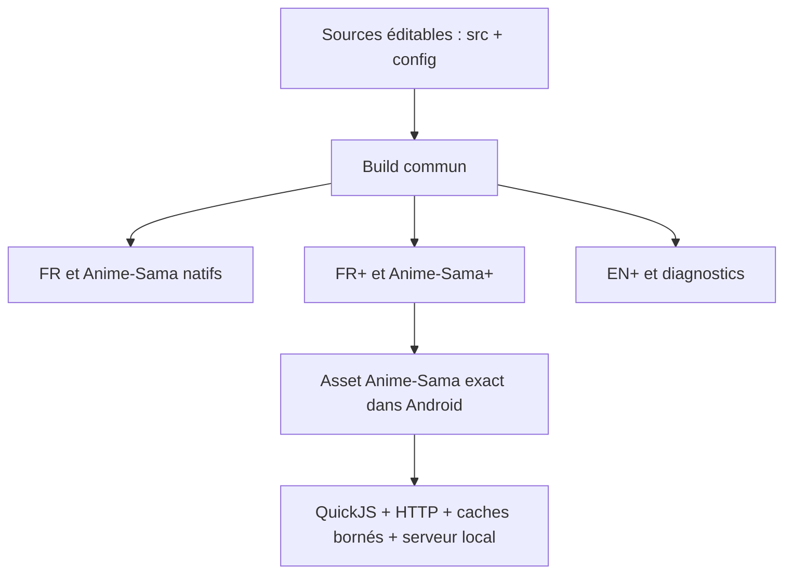

# Architecture

## Produits et code source

`main` porte le code commun et toutes les distributions. « + » désigne la
correspondance configurée des épisodes ; ce n’est pas une autre source vidéo.
Les versions natives restent disponibles indépendamment.

| Produit | Manifeste | Mode de métadonnées |
| --- | --- | --- |
| Sources FR | `manifest.json` | Natif |
| Anime-Sama | `plugins/anime-sama/manifest.json` | Natif |
| Sources FR+ | `plugins/sources-fr-plus/manifest.json` | Adaptateur configuré |
| Anime-Sama+ | `plugins/anime-sama-plus/manifest.json` | Adaptateur configuré |
| Sources EN+ | `plugins/sources-en/manifest.json` | AniBridge + adaptateur configuré |
| Correspondance — Diagnostic | `plugins/episode-diagnostics/manifest.json` | Test des adaptateurs, sans vidéo |

`config/distributions.json` énumère ces chemins. Chaque manifeste possède ses
versions et identifiants d’entrées. Les chemins relatifs de ses fournisseurs
restent locaux à son répertoire. Les identifiants, l’état activé/désactivé et le
regroupement des hébergeurs sont conservés. Toutes les entrées actives d’une même
famille/variante partagent leur nom, car Nuvio trie d’abord par nom de fournisseur.

## Responsabilités

- `src/resolvers.js`, `hls.js`, `media-validation.js`, `selection.js`, `seek.js` et
  `mp4.js` : extraction et validation vidéo partagées par FR et Anime-Sama.
- `src/input-metadata.js` : contrat AIOmetadata/Xperience, sélection de l’épisode
  réellement affiché, preuves de correspondance et paramètres privés.
- `src/episode-mapping.js` : orchestration FR et dispositions propres à chaque backend.
- `src/anime-sama/` : recherche Anime-Sama, identité, éditions, groupes et positions.
- `src/sources-en/` : AniBridge, veto ani.zip, Ani.pm/Settlar, pistes et présentation EN.
- `src/stream-order.js`, `link-layout.js`, `fr-presentation.js` : présentation après validation.
- `scripts/build.cjs` : assemblage des profils ; `scripts/bundling/module-bundle.cjs` :
  empaquetage des modules locaux, sans dépendance Node dans les fournisseurs livrés.

Le build natif fixe `INPUT_METADATA_ENABLED=false`. Les paramètres privés sont
masqués et ne peuvent activer l’adaptateur, même si d’anciens réglages sont injectés.
Les règles natives de récupération des épisodes restent présentes. Le build « + »
active la capacité existante ; ses réglages explicites et ses preuves restent
nécessaires. Un identifiant IMDb ne permet pas de deviner l’ordre de l’utilisateur.

Partager les résolveurs ne signifie pas imposer les mêmes dispositions à tous
les backends, ni remplacer les règles EN par celles de FR. Aucun cache universel
de coordonnées d’épisodes n’est introduit.

## Android

Le projet vit dans `android/addon-host/`. Son `core/` contient le serveur local,
QuickJS, le transport, les caches et la vérification d’identité ; `app/` contient
l’interface, le stockage Android, le service et son cycle de vie.
Sources Host0.3.0 charge les bundles **+** générés d’Anime-Sama, FR et EN via
`hosted-engines/bundled.json`. Aucun résolveur/mapping n’est réécrit en Kotlin.
Un registre par famille conserve les IDs d’entrée, budgets et langues propres.
Le transport/caches sont partagés : six transferts HTTP, deux recherches et trois
contextes QuickJS actifs globalement. Les résultats signés ne sont jamais cachés.

L’identité installée `local.animesama.host`, le stockage et le certificat restent
inchangés. La migration crée un addon Anime-Sama avec l’ancien token/ID public ;
les suivants ont chacun leur capacité. Un addon choisit un manifeste partagé,
son ordre, ses éditions et son accès. Le listener local/LAN8765 et le backend
HTTPS loopback8766 appliquent leurs règles indépendamment. Modifier/mettre en
pause un addon ne reconnecte pas un tunnel inchangé et ne vide pas les caches.

`EnginePackages` vérifie les mises à jour signées, les hashes et le contrat API1
avant activation atomique. Un appel capture une seule version, les bytecodes sont
scopés par génération et l’ancienne version reste disponible pour rollback.
Les contrôles démarrage/utilisation sont asynchrones avec cooldown six heures,
sans polling inactif. Voir la [procédure de publication](host-engine-updates.md)
et le [guide Android](../android/addon-host/README.md).

## Publication et historique

Les URL de `main` sont canoniques. La branche `aiometadata-input` devient une
surface de compatibilité générée pour les installations existantes. Son export
reprend les manifestes et bundles « + » aux anciens chemins, sans seconde source
à maintenir. [Le handoff](handoff.md) décrit les commandes et les garde-fous.

`docs/investigations/`, `docs/archive/`, `tests/evidence/` et `VERIFICATION.md`
conservent les observations datées. Les branches et worktrees locaux ne sont pas
supprimés automatiquement : certains contiennent encore du travail non publié.
