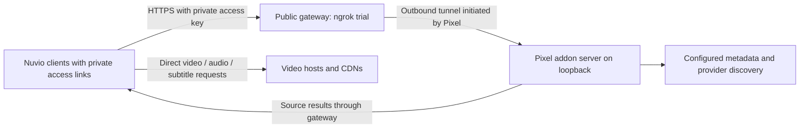

# Pixel-hosted addons: remote access and validation plan

Written 23 November 2026; updated 24 November 2026. **Planning document; implementation has not started.**
This records the intended outcome, proposed sequence and unresolved decisions.
It does not change the APK, publish a service, create an account or schedule tests.

## 1. Intended outcome

Use a spare **Pixel 6** as an efficient, persistent addon host. Nuvio Mobile and
Nuvio TV, including the user's Xiaomi TV Box S 3rd gen, should be able to request
sources both at home and on other networks, **without installing a VPN on clients
or modifying Nuvio itself**.

**Access decision confirmed by the user on 24 November:** private, revocable
bearer links are sufficient. The concern is someone discovering/copying the URL,
not identifying the physical hardware using it. Use a cryptographically random
key in an HTTPS addon URL, with rotation/revocation and bounded request limits.
Hardware registration, certificates and device attestation are not requirements.

The 128-bit random token is impractical to guess, but possession grants access:
sharing, screenshots, synced profiles and request logs can expose it. HTTPS and a
secret hostname alone do not replace the key. Present this scope accurately,
without requiring the user to approve hardware or install a client VPN.

The Pixel resolves sources; **video should travel directly from the video host
to the playback device**. Do not silently introduce video proxying/transcoding.
Aim for one maintainable Android app, shared infrastructure and one addon per
family rather than a separate addon for each video host.

Start with the existing Anime-Sama engine. Sources FR and Sources EN are later
stages, preserving their independent source, mapping and language policies.
Existing native and + plugins remain available and unchanged by this project.

## 2. Current state and evidence

- Android Host 0.1.4 provides Anime-Sama only, with local/LAN HTTP, encrypted
  settings, bounded HTTP/concurrency/caches, TV controls and safe setup errors.
  It has no integrated ngrok connector, HTTPS gateway or per-client key registry.
- One host currently has one token. The service is IPv4, loopback by default;
  opt-in LAN binding accepts local/private-LAN clients. A tunnel agent forwarding
  to loopback is a different approach from the earlier Tailscale proposal.
- Five TV-emulator tests and 28 core tests pass for 0.1.4. The user reports that
  setup works but remote navigation needs later polish. This is not acceptance of
  unattended Pixel hosting, all physical-TV playback or remote-network operation.
- The user reports ANSEmbed/Uqload playback surviving Wi-Fi-to-mobile switching.
  An independently tested supplied link returned a valid master, child playlist
  and a small media-segment sample from the cloud. A supplied Ani.pm/Settlar Beta
  link also served playlists and a segment sample from a different network.
- These are individual examples, not proof that every host/CDN/link is portable,
  that a full episode decodes correctly, or that links remain valid indefinitely.
- Decoding an embedded upstream URL and stripping timestamp-like parameters is
  **not** the selected strategy. Preserve signed URL bytes, headers, original HLS
  masters and embedded tracks. Parameter names alone do not prove expiry rules.

## 3. Proposed architecture



Only addon JSON travels through the gateway. There is no inbound router port to
open. The Pixel must be online, and both the connector and addon server must be
running. A stable gateway URL should work across client networks and Nuvio sync.

A working tunnel does not remove a media host's IP/session restrictions. If a
host requires video requests to share the Pixel's public IP, direct remote
playback may remain unsupported. Do not solve that by automatically relaying
video: it would change bandwidth, heat, cost, quotas and architecture, and needs
a separate decision.

### Metadata compatibility and synced profiles

**Required outcome added 24 November:** the hosted addon must work with the
actual AIOmetadata or Xperience configuration used for a Nuvio profile, including
TMDB numbering and TVDB anime with IMDb compatibility IDs. Existing adapters are
reused; this is not permission to replace their verified episode-matching rules.

Current capability: the app can select AIOmetadata or Xperience and save both
manifest URLs, but it runs one global active configuration. A selection change on
the host therefore affects every client of that hosted endpoint. Simultaneous
mixed-profile support and automatic Nuvio metadata-addon detection are not
implemented.

A normal Stremio stream request supplies media type and a video/episode ID. It
does not reliably identify the installed personal metadata manifest or the addon
that produced the episode list. The same IMDb ID/coordinates can mean different
episodes under different numbering. Search catalogue branding is not proof of
which addon supplied the detail page. Do not guess the provider from ID prefixes,
season counts, artwork preference or the first response returning results.

#### Recommended mechanism: explicit saved presets

1. Save named metadata presets on the Pixel, for example `Xperience — TVDB anime`,
   `AIOmetadata — TVDB anime` and `TMDB/native reference`. They contain the actual
   personal manifest, adapter, query namespace, declared/verified input order and
   relevant credentials. Keep the manifest URL private on the host; never put it
   or the TMDB key into public addon URLs.
2. Export a stable addon installation URL selecting an opaque preset identifier
   plus the normal access key. Illustrative route, not a shipped API:

   ```text
   https://gateway.example/<access-key>/p/<preset-id>/anime-sama/manifest.json
   ```

   Authorization and numbering are separate: an access key must be allowed to
   use the requested preset. Knowing/changing a preset ID is not authorization.
   A preset ID itself is not the private metadata manifest or its access token.
3. Install the matching URL once in each Nuvio profile. Phone/TV sharing that
   profile can sync the same URL, key and metadata preset. A profile with another
   metadata setup gets its own matching URL. No Nuvio patch or client VPN is needed
   for this explicit-selection design.
4. Resolve every incoming request against its saved preset, not a global adapter
   toggle. Editing another preset must not change this client's episode order.
   A deliberate edit to a shared preset affects all clients using it and should
   be clear in the host UI. Preserve the old single-token URL as a compatibility
   alias to a defined default preset when migrating existing installations.
5. An invalid/cleared selected preset, missing manifest, conflicting identity or
   unsupported identifier fails explicitly. Never query the inactive manifest or
   silently substitute AIOmetadata for Xperience, or native numbering for TVDB.

This is explicit profile setup, not automatic tracking of Nuvio settings. If the
user later changes the metadata addon/order in Nuvio, they must select/update the
matching hosted preset. Multiple catalogue sources in one profile are safe only
when their actual episode identities/order are compatible with that preset.
Choosing a different search catalogue does not convey configuration to the host.
If a valid but wrong preset accepts an indistinguishable episode ID, the host
cannot reconstruct the unseen Nuvio detail page. Correct setup therefore remains
necessary; do not promise that every wrong-preset choice can be detected.

#### Episode identity at the hosted boundary

Audit the incoming video-ID semantics before extending mixed-profile support.
Native plugins receive displayed season/episode fields separately; a hosted addon
receives an episode ID whose suffix may use a compatibility numbering scheme.
Do not automatically treat that suffix as the displayed TVDB season/episode.
Retain the original full incoming video ID alongside the canonical title identity
through IMDb-to-TMDB normalization, rather than discarding it before selection.

Where configured metadata exposes the exact incoming episode ID, require a unique
matching row in the independently verified series and recover that row's displayed
coordinates/evidence before invoking the existing mapping logic. Preserve current
working paths with fixtures. Duplicated IDs, absent identity or contradictory
provider/order data must fail closed; any supported alternate lookup needs its
own proof, never a same-numbered guess. Verify the actual request path Nuvio sends,
not only manually supplied numeric TMDB controls. Initial supported identifier
formats must be documented; MAL/Kitsu/TVDB namespaces are not implicitly supported
just because the catalogue offers them.

General films/series may use TMDB while anime uses TVDB/IMDb in the same personal
metadata configuration. Keep the current verified automatic/declared-order rules
where supported; EN retains its own stricter mapping requirements. Do not assume
every title in a mixed preset is TVDB, or that changing the ID namespace translates
its episode order. See the [AIOmetadata contract](../aiometadata.md),
[Xperience adapter](../xperience.md) and [shared adapter source](../../src/input-metadata.js).

#### Cache, concurrency and acceptance

Associate lookups/in-flight work/private metadata with a stable preset revision
and its adapter, manifest, order and credentials. Configuration changes cannot
reuse the old interpretation. Share public identity/transport work only where
validated and appropriately credential-scoped; retain global memory/network bounds
rather than allocating the full budget anew for each preset. One request cannot
change another client's active configuration. Inactive manifests stay unqueried.

Test two concurrent Nuvio profiles, one AIOmetadata and one Xperience, with different
season boundaries to expose accidental global-state sharing. Cover TMDB-only and
mixed TMDB/TVDB-anime setups, IMDb compatibility IDs differing from displayed
coordinates, identical-looking IDs that refer to different episode orders, films,
new releases and unsupported IDs. Include existing Hunter S1E1/S2E72, Haikyuu
S2E15 and Vinland S1E1 controls, preserving their verified mapping evidence.
Switching a Nuvio profile must not require changing the Pixel's global settings.

An optional future automatic-selection mode would need unambiguous request-side
context or verified equivalent episode identities across candidate configurations.
Do not silently query both personal manifests, choose whichever returns links or
claim automatic detection from an IMDb ID. It is not required for the first trial.

Nuvio sync may copy an entire bearer URL to other devices. Shared-profile access
is intentional and does not require physical-device verification. Provide named
keys per installation/profile/group where useful, describing revocation at that
actual scope, rather than promising per-device revocation of a shared key.

## 4. Phase A: establish a reproducible Pixel baseline

1. Install the current signed APK on the Pixel, retaining the existing application
   ID/certificate. Configure the selected metadata manifest and TMDB key locally.
   Keep secrets out of GitHub source, reports, APK resources and chat.
2. Verify manifest access and a real stream lookup separately. A manifest200 does
   not prove mapping or source extraction. Test a TMDB/native control and the
   configured TVDB-anime/IMDb path, including known season-boundary fixtures.
3. Test local/LAN playback from phone and Xiaomi TV: start, seek, available audio
   and subtitles. Reuse the current output and host coverage as the baseline.
4. Measure cold/warm lookup latency, HTTP counts, memory and idle CPU on the real
   Pixel. The existing hosted addon returns a complete JSON list, not per-host
   partial results. Measure time until links actually appear in Nuvio; do not
   promise native per-entry progressive behaviour from one hosted endpoint.
   No numerical speed promise before these measurements.
5. Check screen off, opening other apps, service stop/restart, reboot, Wi-Fi loss
   and recovery. Keep it powered and ventilated; evaluate Android background
   restrictions and charging/battery behaviour without promising unkillable service.

**Gate A:** reproducible correct episode discovery and acceptable idle behaviour
on the Pixel. Record unresolved device/setup failures before adding a tunnel.
A first one-profile trial can use the existing explicit adapter selection.
Before serving different metadata profiles concurrently, implement and verify the
saved-preset routing above; do not use the global toggle as multi-profile support.

## 5. Phase B: test ngrok feasibility without changing the engines

The user's preferred first experiment is **ngrok Free**. Documentation reviewed
23 November 2026 describes one assigned stable development domain, 20,000 HTTP
requests and 1 GB outgoing transfer per month. Treat those as a dated reference;
recheck [limits](https://ngrok.com/docs/pricing-limits/free-plan-limits) and
[domain behaviour](https://ngrok.com/docs/gateway/domains) before deployment.
Quotas cover gateway traffic, not the separate upstream discovery requests made
by the Pixel. They are not a reason to route video through this gateway.

- Prove a supported/reproducible connector can run on the Pixel's Android system.
  Do not assume a Linux ARM64 binary automatically works on Android. Evaluate a
  separate Android-compatible companion first; integrate only after lifecycle,
  licensing, update and secret-storage requirements are established.
- The user creates/configures their own gateway account and supplies its token
  locally. No account credentials compiled into code or public Actions inputs.
- Start with loopback forwarding to the existing server. Do not broadly relax
  its inbound-address filter or expose its LAN socket to the public internet.
- Test actual Nuvio requests: manifest JSON, stream JSON, URL path encoding,
  relevant methods, redirects, CORS where needed, timeouts and error status.
- The free browser interstitial/login/challenge must not replace JSON for Nuvio.
  Do not depend on a browser session or a client header Nuvio cannot supply.
- Verify stable address after connector restart, token-path preservation and the
  connector's backoff/reconnection behaviour. Measure its additional idle cost.
  A tunnel may require keepalives even though the addon does no content polling.

**Gate B:** remote Nuvio can reliably reach the existing token-protected addon
without a VPN/client modification or browser login, within the free plan's limits.
If ngrok is unsuitable, record the failure before choosing a fallback. Cloudflare
Tunnel with an owned domain is an alternative; its domain cost and Android
connector feasibility require review. Temporary Quick Tunnel addresses are for
experiments, not the default persistent installation URL.

## 6. Phase C: private access and operational controls

Before treating the endpoint as a regular public service:

- Require a cryptographically random secret on every manifest and stream route.
  The existing 128-bit token is the minimum baseline; do not rely on a secret
  hostname. No unauthenticated source lookups or remote settings editor.
- Add named, revocable/rotatable installation or profile keys as needed. Revoke
  one key without changing other configurations. Never describe a copied bearer
  URL as physical-device verification.
- Account for Nuvio sync before assigning key scopes. Start with the user's own
  devices; no implicit invitation or publication to third parties.
- Retain bounded connections, body sizes, queues and lookup deadlines. Add limits
  by logical access key; a loopback tunnel makes raw socket IPs unsuitable as the
  sole client identity. Do not trust arbitrary forwarded-IP headers.
- Redact tokens/queries in logs and diagnostics; explain that Nuvio sync and the
  HTTPS gateway provider can see/store URLs. Do not publish private manifests,
  signed media links, session cookies, caption dialogue or raw HTTP bodies.
- Test missing/wrong/revoked keys, malformed requests, queue saturation and
  recovery. Invalid authorization must not trigger metadata/provider requests.
- Provide clear local status and stop/reconnect controls without continuous
  monitoring. Preserve visible manifest/key fields and screenshots as requested.

**Gate C:** access is limited to holders of explicitly issued keys, denial and
revocation work, and normal clients remain usable under the bounded load tests.
Gateway requests can still consume free quota before app authorization; a secret
URL is not a guarantee against service exhaustion.

## 7. Phase D: host-by-host cross-network validation

Build a matrix from actual configured/resolved providers. The shared resolvers
currently recognize ANSEmbed, Uqload, Smoothpre, Voe, Vidmoly, Sendvid, Vidzy,
Dood, Streamwish, MixDrop, Vidara, Seek, Dropload and ShareCloudy. This recognition
list does not establish that every host has an available sample today.

Start with Anime-Sama's independent entries, then extend to FR and Ani.pm using
the existing native test engines. Hosted FR/EN need not exist to test their media
URLs; do not confuse these protocol probes with completed Android integration.

For each available provider/host/CDN/format combination:

1. Obtain fresh links for at least two representative titles where available;
   cover an episode/movie, old/recent releases and useful editions as applicable.
   Confirm selected episode identity before interpreting media failures.
2. Establish the issuing-network baseline using original URLs and headers. Check
   master/child playlists, init/encryption-key resources when present, bounded
   beginning/middle/end media samples and advertised preferred audio/subtitles.
   For direct MP4, check range support and bounded media readability. HTTP200
   alone is not enough; do not download entire episodes as a default probe.
3. Test the **same issued URL and headers** from a genuinely different public
   egress. Do not regenerate it on the second network. Cloud plus GitHub Actions
   can supply automated locations after verifying their egress differs.
4. Repeat selected links at known elapsed ages, initially around 1h, 12h and 24h.
   These are controlled test retention, not a production playback-URL cache.
   If an old link fails, compare a fresh same-source link to distinguish expiry
   from a current host outage. Do not infer lifetime solely from query arguments.
5. Protect the cross-network handoff before automating: ephemeral encrypted/private
   transfer, bounded retention and cleanup, no plaintext signed URLs in public
   workflow inputs, logs, source or artifacts. If that cannot be arranged, record
   the gap rather than publishing tokens. No deferred jobs are scheduled by this plan.
6. Separate extraction failure, source absence, HTTP restriction, expiry, missing
   tracks and decode failure. An unavailable sample is **untested**, not proof of
   IP binding. Cloud blocking is not proof the user's host is broken.

Report only sanitized title/episode IDs, provider/host/format, test locations,
link age, HTTP stages/status, sample results and limitations. Classify outcomes
as cross-network working, restriction suspected, expiry observed, unavailable or
untested; retain supporting fresh controls before asserting the cause. Never
promise every future link from a host will behave like one successful sample.

### Physical checks and division of work

Codex can build the harness, reuse discovery/mapping regressions, perform bounded
network probes, compare independent environments and prepare the report.

The user supplies Pixel/account setup and real Nuvio acceptance: phone on mobile
data, TV on its network, start/seek/audio/subtitles, and ExoPlayer/libmpv where
relevant. The user already reports libmpv startup failing on some Ani.pm streams
while ExoPlayer plays them; classify player compatibility separately from remote
URL accessibility. Cloud HTTP success does not diagnose that failure.

Ask for an individual fresh playback URL only if cloud discovery cannot obtain
a representative source. Do not ask the user to copy every host's links or expose
personal metadata manifests/API keys. Follow-up is only for genuinely unavailable
credentials, account actions or physical-device observations.

**Gate D:** required initial hosts have real cross-network evidence plus device
playback checks, with unsupported/untested combinations explicitly listed. Do not
claim universal remote playback. Keep a local hosting option for unsupported cases;
video proxying, VPN routing or replacing a host are separate future decisions.

## 8. Phase E: shared app architecture and additional engines

Preserve the current Anime-Sama asset pipeline and exact resolver behaviour.
Introduce a provider registry when implementing FR/EN, with shared configuration,
verified public identity cache, HTTP pool/admission, memory limits and lifecycle.
Keep metadata presets explicit and isolate private inventories by manifest/order.

Add one hosted addon per family, not per host. FR keeps its resolution/backend
rules; EN keeps AniBridge authority, ani.zip contradiction-only veto, language
eligibility and multi-audio masters. Neither may borrow Anime-Sama episode
coordinates merely because the transport is shared. Standard/Beta EN routes and
slow hosts must not accidentally gate independent lookups or multiply global
resource limits. Expose only implemented engines and keep stable native URLs.

Deliver FR and EN separately, with mapping, media, installed-addon and Android
acceptance tests for each. This phase can follow a successful remote Anime-Sama
trial; it is not a prerequisite for that first trial.

## 9. Phase F: longer metadata caches without stale new episodes

Implement the separately agreed [HOST-02 policy](../limitations.md#host-02--longer-metadata-caching-with-new-release-recovery):
verified title IDs 7 days, general information 24h, explicitly completed episode
inventories 24h, ongoing/unknown inventories 15min as proposed starting limits.
Mixed responses need the shorter policy unless separated safely.

When cached episode metadata blocks a newly requested episode or season, perform
one targeted fresh inventory/selected-addon read and re-run normal identity
checks. Keep unrelated titles and stable identities cached; do not retry forever
or weaken matching. A valid episode followed by no uploads is not a metadata-cache
failure. Preserve bounded memory, lazy expiry and no background preload/polling.

Measure request reductions and cold/warm latency before selecting final durations.
Keep this a separate release from gateway/source fixes where possible, so a
regression can be isolated. No signed playback/token caching or argument stripping
is included. Shared transport optimizations must not alter another engine's policy.

## 10. Delivery sequence and acceptance

Suggested order: **A → B/C → D → first remote Anime-Sama release**. E and F are
independent follow-ups after the baseline, not reasons to delay the first trial.

For each implementation, update architecture, host instructions, maintenance
coverage and evidence. Run applicable Node/Python/native and JVM/Android tests;
add synthetic regressions for protocol changes. Exercise installed addon URLs,
not only numeric-ID internal controls. Measure no-search idle separately from
actual lookup load and tunnel keepalives on the real Pixel.

Publish signed APKs using the existing certificate, increasing versionCode.
Preserve saved metadata, access tokens, application ID and working install URLs
or provide an explicit migration/alias. Keep native stable/+ distributions intact.
A rollback to older behaviour must still use an installable higher-versionCode
update if Android would reject downgrading; preserve the original signing key.
Do not claim that an older APK can always be installed over a newer release.

The first real remote deployment is accepted when the Pixel survives normal
screen-off/reconnect conditions, authorized Nuvio devices on different networks
reach a stable HTTPS URL without VPN/browser authentication, selected episodes
map correctly, validated hosts play with their expected tracks, and access can
be revoked without wiping the host configuration. Record outstanding OEM reboot,
player, quota and host restrictions rather than claiming complete reliability.

## 11. Confirmed decisions and remaining setup choices

- **Settled:** revocable possession-based private links satisfy the user's access
  requirement. Hardware/device verification is not needed.
- **Metadata requirement:** support AIOmetadata and Xperience via the actual saved
  profile configuration. Explicit per-profile preset URLs are the recommended
  design; automatic discovery from Nuvio is not assumed. Confirm the desired preset
  names/order settings when configuring the Pixel, not by exposing private URLs.
- Decide whether the initial shared Nuvio profile uses one household key, or
  whether distinct installations/profiles can retain separate keys/presets.
- Confirm Pixel-only connector feasibility and acceptable free-tier behaviour;
  an account, private connector token and physical setup are user-side actions.
- Choose the initial host/format coverage needed for the first trial. No need to
  wait for every legacy host to become available, but list all remaining gaps.
- Decide actual lifetime-test scheduling and supported unattended Pixel behaviour
  after the baseline. This plan does not start or authorize arbitrary background
  jobs, buy a domain, introduce a paid service or proxy video.

These are design choices for the next implementation, not a request to send
secrets or block documenting the plan now.
